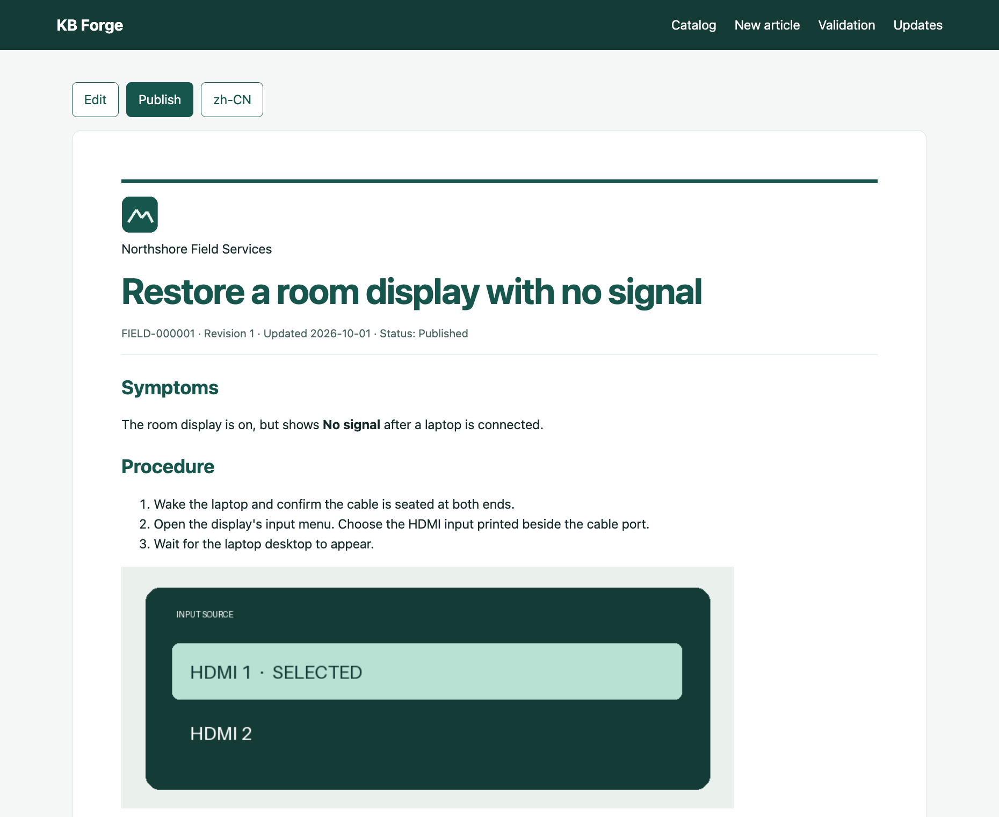

# KB Forge

English · [简体中文](README.zh-CN.md)

KB Forge is a planned toolkit for creating, organizing, validating, and publishing portable knowledge bases. Articles use Markdown with YAML front matter, and images and attachments are stored as ordinary files. The same collection should remain readable and maintainable with ordinary tools if an organization replaces KB Forge.



## Documentation

English and Simplified Chinese (`zh-CN`) documentation are required for the MVP and for each release that changes a documented workflow. Both editions should be complete, easy to navigate, and linked to each other. Update both editions in the same change when behavior, configuration, or the standard changes.

The documentation should include:

- **Documentation standard.** A dedicated, versioned specification that explains the directory layout, metadata fields and allowed values, permanent IDs and organization-defined prefixes, asset naming and placement, relative links, article relationships, translations, regional applicability, and the article lifecycle. Identify required rules, configurable defaults, and examples. Include a complete article and its assets that readers can inspect in a Markdown editor.
- **Getting started and authoring.** Installation and setup, followed by a walkthrough of creating an article, adding an image, finding the article by metadata, fixing a validation finding, previewing the branded article, and exporting a PDF.
- **Configuration and maintenance.** Examples for configuring IDs, metadata, templates, validation, and branding. Explain review and translation updates, common validation failures, and how to use and maintain the collection with ordinary tools.

Keep commands, YAML keys, and identifiers consistent across editions. Translate the explanations, headings, captions, and other reader-facing text. Before release, follow the walkthrough in both languages, check example files and links, and verify that the Chinese sample renders legibly in HTML and PDF.

This requirement applies to KB Forge's own documentation and its demonstration. Organizations can choose which languages to support in their collections, and individual articles may have a single language edition.

## Run the MVP

Install Python 3.11 or later and a current Pandoc with GFM `attributes` support (`pandoc --list-extensions=gfm`). Make sure both are available on your PATH. The workspace needs no cloud account or additional Python packages. The paginated PDF renderer uses optional dependencies.

From the repository root, make a working copy of the demo. The application writes changes to the collection you open.

```sh
cp -R example demo-work
python3 -m kbforge demo-work
```

In Windows PowerShell, use `Copy-Item -Recurse example demo-work` and `py -m kbforge demo-work`. Open [http://127.0.0.1:8765](http://127.0.0.1:8765). Stop the application with Ctrl+C. Use `--port 8766` if the default port is busy.

### Try the demo

1. Open **New article**. Choose **Procedure**, keep **New article** as the source, enter a title and owner, and set a future review date. Enter a distinctive tag such as `demo-cable`. Select **Create draft**. On a fresh copy, the new ID is `FIELD-000005`.
2. Add text under **Purpose** and **Steps**. Place the cursor on the line after which you want the picture. Choose a PNG or JPEG, describe it, and select **Attach images**. Then select **Save changes** to save the text and image reference together.
3. In **Catalog**, search for `demo-cable`. Open the article to check the branding and image. Use **Validation** to find problems. The supplied incomplete practice draft intentionally has a missing owner, a missing section and image, and an overdue review.
4. Select **Publish**, then **Print or save as PDF**. In Chromium, choose **Save as PDF**, turn off the browser's own headers and footers, and check the preview before saving. The print stylesheet supplies A4 margins, page numbers, and the branded title block. Try the Chinese edition of `FIELD-000001` to check the characters and screenshot. Install a Simplified Chinese system font if the print preview shows missing glyphs.
5. In a text editor, open `demo-work/articles/FIELD-000005/en-US.md` and inspect its front matter and relative image link. Open the PNG or JPEG in the article's `assets` folder directly.

Run repository validation without the browser with `python3 -m kbforge demo-work --validate`. Exit code 1 indicates errors. Run the automated tests with `python3 -m unittest discover -s tests`.

## Reference

Read the [KB Forge Documentation Standard](docs/standard.md) for file layout, metadata, lifecycle, translation and migration. The [demo collection](example/kbforge.yaml) shows the identifier format, article templates and organization branding.

The workspace runs on loopback for one local operator per collection. The browser interface is in English. Use the paginated renderer below or the browser's print dialog for PDF export. See the standard for local allocation, Markdown, and import limits.

### Publish a paginated branded PDF

On macOS, Windows, or Linux, install the optional dependencies into the Python environment used to run KB Forge:

```sh
python3 -m pip install -r requirements-pdf.txt
python3 -m kbforge demo-work --export-pdf FIELD-000002 en-US --output article.pdf
```

You can also use **Publish → Open branded PDF**. See the [publishing settings](docs/standard.md#branded-publishing) for cover art, page artwork, and Chinese fonts. Paginated export supports headings, paragraphs, lists, code blocks, local images, and Markdown pipe tables. Table cells use plain text, with alternative text in place of images. Browser print preserves rich inline formatting.

### Move a theme to another collection

1. From the source KB Forge checkout, export the collection theme. Use a new ZIP filename.

   ```sh
   python3 -m kbforge my-collection --export-theme my-theme.zip
   ```

2. Copy the ZIP to the destination computer. In an up-to-date KB Forge checkout, use an existing collection or copy the included `example` directory to `work-collection`.
3. Stop KB Forge if it is serving the destination collection, then import the ZIP and start it again.

   ```sh
   python3 -m kbforge work-collection --import-theme my-theme.zip
   python3 -m kbforge work-collection
   ```

In Windows PowerShell, use `py` in place of `python3` and `Copy-Item -Recurse example work-collection` to copy the sample. Insert the actual path to the ZIP if it is stored elsewhere.

The ZIP contains the `workspace`, `branding`, and `publishing` settings and the assets those sections reference. Articles, numbering, templates, and article-specific PDF covers stay with their collections. Export the destination theme to a separate ZIP first if you want a backup of its settings. Import replaces the three theme sections and stops before updating them if an existing asset has the same name and different contents.

### Back up and restore collections

Save any edits and stop KB Forge before backing up. Run one of these commands from the app directory. Use a new ZIP filename and an existing destination folder outside the collections.

```sh
python3 -m kbforge ../collections/work-collection --backup-collection --output ../work-backup.zip
python3 -m kbforge ../collections --backup-all-collections --output ../collections-backup.zip
```

On Windows use `py` in place of `python3`. The second command finds collections directly under the given parent by their `kbforge.yaml`. Backups include the whole collection, including articles, IDs, configuration, branding, and local assets. The command verifies the ZIP and rejects symlinks and special files. Store a copy separately from the application and collection.

To restore, extract your ZIP into a new folder. Open the extracted collection by passing the folder that contains its `kbforge.yaml`, for example `python3 -m kbforge ../restored/work-collection`. Check a few articles and their images before switching to it. For a single recovered article, use [article package import](docs/standard.md#article-packages). An unused, unreserved ID ending in `00001` can be imported even if automatic allocation starts at 2.

### Update the app

For a Git clone, use **Updates → Check and install update** or run the following from the app directory after stopping the server.

```sh
python3 -m kbforge --update
```

KB Forge fetches the current branch's configured upstream and applies fast-forward updates. Git blocks collisions with local files. Use `git status --short` to inspect tracked edits if they block the update, and use Git to reconcile any local-only commits. The updater follows the upstream branch independently of release tags. After an in-app update, stop the server with **Ctrl+C** and launch it again. If optional PDF dependencies changed, reinstall them with the command above.

For a ZIP installation, extract the [new release](https://github.com/iandorsey00/kb-forge/releases) alongside the old app folder, then launch the new copy with the path to your existing collection. Keep your collection outside the application folder so you can replace the software independently. Back up and open the collection successfully before removing the old installation.

### Create a blank collection

Run this from the checkout with a new destination directory:

```sh
python3 -m kbforge work-collection --init --name "Support Knowledge Base" --prefix SUPPORT --digits 5
python3 -m kbforge work-collection
```

This creates a minimal configuration, an empty ID registry and article directory, and a generic article template. Use `--language` to set the first language (default `en-US`). Import a theme ZIP to add branding later. In Windows PowerShell, use `py` in place of `python3`.

### Work with many images

Export the relevant pictures from the source presentation, or copy a screenshot to the clipboard. On the article edit page, select several files at once, drag them onto the editor or attachment form, or paste a clipboard image into the editor. Check the alternative text for each, set an optional **Width for this batch (%)**, and select **Attach images**. The Markdown references go below the current line in the order shown in the queue. The files are stored immediately. Save the draft to keep the references.

For images that belong to a list item, place the cursor on the line with its list marker. KB Forge picks up the indentation. To override it, set **Indentation for list images** to the number of characters before the item text, counting the marker. For example, use 3 spaces for `1. Step` and 2 for `- Step`. Adjust individual widths afterward with `{width=60%}`. See the [Markdown example](docs/standard.md#images-links-and-branding). Validation can identify unreferenced assets if you abandon a draft.

### Export a static site

```sh
python3 -m kbforge work-collection --export-site --output published-site
```

Install the PDF dependencies above and use a new output directory. The output includes an index, a shared stylesheet, a `manifest.json` listing edition IDs, languages, revisions, and relative output paths, and a branded HTML page and PDF for each published language edition. Each edition's files sit side by side at `articles/<id>/<language>.html` and `articles/<id>/<language>.pdf`, relative to the output directory. The homepage is `index.html` at the root, and both it and each article page link to the matching PDF. Images are embedded in the HTML, and site links are relative. Open `index.html` locally or copy the entire output directory to a static web host.

If PDF generation fails, the export reports the article ID and language and removes the incomplete output. Chinese PDFs require a font with the needed glyphs. Use `--export-site --html-only` to omit PDFs and their links. That mode works without the PDF dependencies.

### Publish and roll back a site

Add named filesystem destinations to the collection's `kbforge.yaml`:

```json
"publication_destinations": {
  "preview": "../preview-site",
  "team": "/path/to/mounted-share/team-site"
}
```

Use an absolute path or one relative to the collection directory. Each destination needs its own empty folder or a new folder under an existing parent. A local folder, mounted network share, or locally synced folder works through the same interface. Keep the destinations separate from the collection source.

```sh
python3 -m kbforge work-collection --publish-site preview
python3 -m kbforge work-collection --publish-site preview --apply
python3 -m kbforge work-collection --rollback-site preview
python3 -m kbforge work-collection --rollback-site preview --apply
python3 -m kbforge work-collection --copy-site preview --output offline-site
```

Preview compares published editions with the destination's current release. Apply builds a complete snapshot in `releases/<release-id>/` and then switches the destination's root `index.html` to it. Share the root homepage as the stable entry point. The release homepage's **What’s new** section lists up to ten recently published or updated editions. Add an optional `release_note` string to an edition's front matter for a reader-facing summary. Rollback chooses the active release's predecessor by default, or you can specify `--release ID`. A rollback changes the active site without changing the source collection. Old release URLs remain readable wherever the destination is served, so use host access controls and remove any retained snapshot that must be withdrawn.

`--copy-site` copies the current published snapshot for offline reading. A named destination receives one-way publishes from its source collection. For synced folders, visibility on other machines depends on the sync tool.

### Collaborate on an editable site

Use one dedicated folder accessible to all editors, such as a mounted network share with normal file locking and atomic rename support. The folder contains `site/` for readers and `source/` for editors. Serve only `site/` and give editors access to the collaboration folder. Source snapshots include drafts, the ID registry, and branding. Each editor configures their own backup and named publishing paths.

The first publisher creates the shared site from their existing collection:

```sh
python3 -m kbforge work-collection --push-site /path/to/team-kb --apply
```

Another editor clones it into a fresh local directory and opens the clone in KB Forge:

```sh
python3 -m kbforge --clone-site /path/to/team-kb --output my-editable-kb
python3 -m kbforge my-editable-kb
```

After saving edits, preview and apply the merge. Set an article's status to `published` to include it on the reader site. Add `--html-only` when pushing if the reader site only needs HTML.

```sh
python3 -m kbforge my-editable-kb --push-site /path/to/team-kb
python3 -m kbforge my-editable-kb --push-site /path/to/team-kb --apply
```

Changes to different files merge automatically. When two editors independently allocate the same new ID, KB Forge keeps the shared ID, moves the incoming article to the next free ID, and updates its editions, conventional relative Markdown links, and `related` references. Preview shows the proposed mapping. Both editors changing the same existing file differently stops the push and lists the conflicting paths. Clone the latest shared version into a fresh directory, reconcile those files there, and carry over the rest of your edits before pushing. A successful push also tells you to clone again if other editors' changes or ID reassignment made the shared snapshot differ from your working copy. Your local article files are preserved.

### Distribute a site through OneDrive or SharePoint

| What readers or editors need | What to share |
| --- | --- |
| A browsable site in a web browser | Deploy the full export to an approved static web host. Link to its homepage from SharePoint. |
| PDFs they can open from the document library | Upload the published PDFs to a SharePoint library or a shared OneDrive folder. |
| The complete site for offline reading | Share the complete export folder or a ZIP of it. Readers sync or extract the whole folder and open the local `index.html`. |
| An editable collection | Share the collaboration folder with editors only. They sync the folder and clone from its local path. |

**OneDrive.** Upload or copy the exported folder into OneDrive and share it with the intended readers. Keep its folder structure intact so the article, stylesheet, and PDF links work after download. For an editable clone, the shared folder must be the collaboration root containing both `site/` and `source/`. An eligible internal recipient can use **Add shortcut to My files** and the OneDrive sync app to get a folder in Finder or File Explorer. Wait until the release has synced and its files are available locally, then run the command below. Use the recipient's actual filesystem path. [Microsoft's OneDrive shared-folder guide](https://support.microsoft.com/en-us/onedrive/add-shortcuts-to-shared-folders-in-onedrive)

```sh
python3 -m kbforge --clone-site "/path/to/OneDrive/team-kb" --output my-editable-kb
```

**SharePoint Online.** Open the document library and choose **Upload** to add the PDFs, export folder, or ZIP. For offline reading or cloning from an editors-only library, use **Add shortcut to OneDrive** or **Sync** where available, then work from the resulting local path. SharePoint Online's default file handling may download or preview HTML as content. Use a static host for an interactive site with working navigation and CSS. [Upload to a library](https://support.microsoft.com/en-us/sharepoint/documents-and-library/upload-files-and-folders-to-a-library) · [Sync a library](https://support.microsoft.com/en-us/onedrive/sync/sharepoint-training/sync-sharepoint-files-and-folders) · [SharePoint HTML file handling](https://learn.microsoft.com/en-us/sharepoint/dev/solution-guidance/security-permissivesetting)

Use **one designated publisher on one machine** for destinations reached through OneDrive sync, including synced SharePoint libraries. Sync uses local copies, so KB Forge's push lock cannot coordinate concurrent pushes across machines. For multiple publishers, use a mounted share where all editors operate on the same filesystem with atomic directory creation and rename. Keep the collaboration root and `source/` restricted to editors. When readers need access, share the exported folder, PDFs, or `site/` separately.

### Schedule collection backups

Add a schedule to `kbforge.yaml`. This example backs up the collection every 24 hours to a sibling directory. Use an existing parent folder.

```json
"scheduled_backup": {
  "directory": "../collection-backups",
  "interval_hours": 24
}
```

While KB Forge is running, it checks at startup and once a minute. It creates a verified ZIP on the first run, then another when the configured number of hours has passed since the last archive. Each ZIP is retained. To check the schedule while the app is closed, run the following command from the KB Forge checkout using cron, Windows Task Scheduler, or another OS scheduler. Use the full paths to your Python interpreter and collection when setting up the task.

```sh
python3 -m kbforge work-collection --run-scheduled-backup
```

The editor is a loopback service for one local operator. Share exported sites with multiple readers, and coordinate editing of the source collection separately.

### Manage fonts, identifiers, and releases

For a consistent Latin PDF font, place a static TrueType font such as Inter under `branding/` and set `publishing.font` to its filename. Chinese editions need a font with Chinese glyphs. Re-export from Markdown to apply font changes and recalculate pagination. An imported PDF cover keeps its original typography.

Keep existing IDs as ownership changes. Switch the prefix for new articles when an official numbering scheme is adopted. If existing articles must be renumbered, keep an old-to-new map and preserve each original ID in metadata. Update references and regenerate the affected exports.

App releases use Git tags such as `v0.1.0` with a [changelog](CHANGELOG.md). Collection format and article revisions are independent of app releases. The in-app updater follows the configured Git upstream branch.
