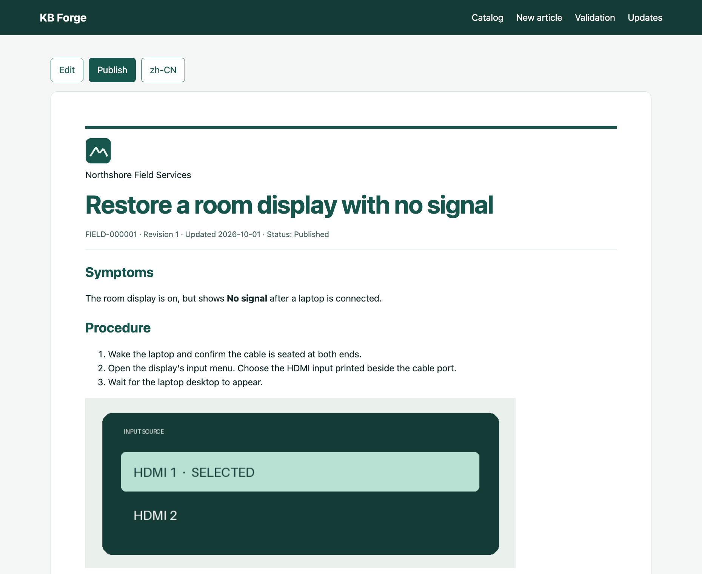

# KB Forge

[English](README.md) · 简体中文

KB Forge 是一套工具，用于创建、组织、校验和发布可迁移的知识库。文章采用 Markdown 编写，元数据保存在文件开头的 YAML 区块中，图片和附件以普通文件保存。即使组织日后更换 KB Forge，也应能使用常见工具阅读和维护原有知识库。



## 文档

每次改变文档所述操作流程的发布，都必须提供完整的英文和简体中文（`zh-CN`）文档。两个版本应便于查找，并提供相互跳转的链接。产品行为、配置或文档标准发生变化时，应在同一次变更中更新两个版本。

文档应包括以下内容：

- **文档标准。** 提供独立成章、具有版本号的规范，说明目录结构、元数据字段及允许值、永久文档编号和组织自定义前缀、资源文件的命名和存放位置、相对链接、文章之间的关系、译文管理、地区适用范围以及文章的生命周期。明确必遵规则、可配置的默认值和示例，并提供一篇附带资源文件的完整文章，供读者用 Markdown 编辑器查看。
- **快速入门与文章编写。** 说明如何安装和配置工具，并通过实例演示创建文章、添加图片、按正文和元数据查找文章、修复校验发现的问题、预览带品牌样式的文章以及导出 PDF。
- **配置与维护。** 提供编号、元数据、模板、校验规则和品牌样式的配置示例。说明如何复审文章、更新译文、处理常见校验问题，以及如何使用常见工具继续使用和维护知识库。

两个版本应使用相同的命令、YAML 字段名和标识符。说明文字、标题、图注等面向读者的内容应提供对应译文。发布前，按两个语言版本的指引分别走完操作流程，检查示例文件和链接，并确认中文示例在 HTML 和 PDF 中均能清晰显示。

上述双语要求适用于 KB Forge 自身的文档和演示。各组织可以自行决定知识库支持哪些语言，单篇文章可以只提供一个语言版本。

## 快速入门

安装 Python 3.11 或更高版本，以及支持 GFM `attributes` 扩展的新版 Pandoc（可运行 `pandoc --list-extensions=gfm` 确认）。确保终端可以运行这两个程序。工作区无需云端账户或额外的 Python 软件包。分页 PDF 渲染器使用可选依赖。

在项目根目录中复制演示资料。应用会直接修改所打开的知识库。

```sh
cp -R example demo-work
python3 -m kbforge demo-work
```

在 Windows PowerShell 中，使用 `Copy-Item -Recurse example demo-work` 和 `py -m kbforge demo-work`。打开 [http://127.0.0.1:8765](http://127.0.0.1:8765)。按 Ctrl+C 退出。如果默认端口被占用，可加上 `--port 8766`。

### 体验演示流程

1. 打开 **New article**（新建文章）。选择 **Procedure**（操作规程），将来源保持为 **New article**，填写标题和负责人。展开 **Additional details**（其他详细信息），设置未来的复审日期，再添加一个便于搜索的标签，例如 `demo-cable`。点击 **Create draft**（创建草稿）。在刚复制的演示资料中，新文章编号为 `FIELD-000005`。
2. 在 **Purpose**（目的）和 **Steps**（操作步骤）下填写正文。使用 **Split**（分屏）可边写边查看 Markdown 的渲染效果。将光标移到需要插入图片的上一行，在 **Images**（图片）中选择 PNG 或 JPEG 图片并填写描述，再点击 **Insert images**（插入图片）。最后点击 **Save changes**（保存更改），一并保存正文和图片引用。
3. 在 **Catalog**（目录）中搜索 `demo-cable`。打开文章，检查品牌样式和图片。通过 **Validation**（校验）查找问题。演示资料中的练习草稿故意缺少负责人、必要章节和图片，且已超过复审日期。
4. 点击 **Publish**（发布），然后选择 **Open branded PDF**（打开品牌 PDF）在新标签页中预览，或选择 **Download PDF**（下载 PDF）保存为 `<编号> <标题>.pdf`。如未显示按钮，请按下文安装 PDF 支持。可打开 `FIELD-000001` 的中文版，检查汉字和截图是否清晰。
5. 用文本编辑器打开 `demo-work/articles/FIELD-000005/en-US.md`，查看文件开头的元数据和图片相对链接。直接打开该文章 `assets` 目录中的 PNG 或 JPEG 图片。

可通过 `python3 -m kbforge demo-work --validate` 在终端中校验知识库。退出状态码 1 表示存在错误。运行 `python3 -m unittest discover -s tests` 可执行自动化测试。

## 参考资料

参阅[架构与实施优先级](docs/architecture.zh-CN.md)，了解设计决策、当前限制及改进顺序。

参阅 [KB Forge 文档标准](docs/standard.zh-CN.md)，了解文件结构、元数据、文章生命周期、译文管理及迁移方法。[演示配置](example/kbforge.yaml) 提供了编号格式、文章模板和组织品牌样式的实例。

通过[自定义元数据字段](docs/standard.zh-CN.md#自定义元数据字段)，可在文章编辑器中添加指定类型的字段，并按需设置默认值。

工作区仅监听本机地址，适合单人在本地维护知识库。浏览器界面为英文。可通过下文所述的分页渲染器导出 PDF。有关本地编号分配、Markdown 和导入的限制，请参阅文档标准。

### 发布带品牌样式的分页 PDF

在 macOS、Windows 或 Linux 上，使用运行 KB Forge 的同一 Python 环境安装可选依赖：

```sh
python3 -m pip install -r requirements-pdf.txt
python3 -m kbforge demo-work --export-pdf FIELD-000002 en-US --output article.pdf
```

也可以在 **Publish → Open branded PDF** 中查看结果。有关封面、品牌图片和中文字体，请参阅[发布设置](docs/standard.zh-CN.md#品牌样式与发布)。分页导出支持标题、段落、列表、代码块、本地图片及使用竖线编写的 Markdown 表格。围栏代码块（包括标记为 `text` 的代码块）保留空白并带有底色，ASCII 文本采用等宽字体。表格单元格以纯文本呈现，图片以替代文字显示。如需打印纸质版或调整打印机设置，请在 PDF 查看器中打印已发布的 PDF。

### 将主题迁移到另一个知识库

1. 在源电脑的 KB Forge 项目目录中导出主题。请使用尚不存在的 ZIP 文件名。

   ```sh
   python3 -m kbforge my-collection --export-theme my-theme.zip
   ```

2. 将 ZIP 复制到目标电脑。在已更新的 KB Forge 项目目录中使用现有知识库，或将附带的 `example` 目录复制为 `work-collection`。
3. 如果目标知识库正在运行，请先停止 KB Forge，然后导入主题并重新启动。

   ```sh
   python3 -m kbforge work-collection --import-theme my-theme.zip
   python3 -m kbforge work-collection
   ```

在 Windows PowerShell 中，可用 `py` 代替 `python3`，并通过 `Copy-Item -Recurse example work-collection` 复制示例知识库。如果 ZIP 位于其他目录，请填写实际路径。

ZIP 包含 `workspace`、`branding` 和 `publishing` 设置及其引用的资源。文章、编号、模板和文章专用 PDF 封面保留在各自的知识库中。如需备份目标主题，请先将其导出到另一个 ZIP。导入会替换这三个设置区块；若已有同名但内容不同的资源，导入会在更新设置前停止。

### 备份与恢复知识库

先保存文章并停止 KB Forge，再从应用目录运行以下任一命令。请选择尚未使用的 ZIP 文件名，并保存到知识库以外的现有目录。

```sh
python3 -m kbforge ../collections/work-collection --backup-collection --output ../work-backup.zip
python3 -m kbforge ../collections --backup-all-collections --output ../collections-backup.zip
```

在 Windows 上，可使用 `py` 代替 `python3`。第二条命令通过 `kbforge.yaml` 识别指定父目录下的知识库，只查找直接子目录。备份包含整个知识库，包括文章、编号、配置、品牌样式和本地资源。命令会校验 ZIP，并拒绝符号链接和特殊文件。请将一份备份存放在应用和知识库目录之外。

恢复时，将 ZIP 解压到新目录。启动 KB Forge 时，传入包含 `kbforge.yaml` 的已解压知识库目录，例如 `python3 -m kbforge ../restored/work-collection`。切换之前，请打开几篇文章并检查图片。如果只恢复一篇文章，请使用[文章包导入](docs/standard.zh-CN.md#文章包)。即使自动编号从 2 开始，仍可导入未使用且未预留的 `00001` 号。

### 更新应用

通过 Git 克隆安装时，可选择 **Updates → Check and install update**（更新 → 检查并安装更新），也可停止服务后，从应用目录运行以下命令。

```sh
python3 -m kbforge --update
```

应用会在启动时和之后每隔 15 分钟检查已配置的上游分支，并刷新 Git 跟踪信息。有可快进应用的更新时，导航栏中的 **Updates** 会变为 **Update app…**，仍打开同一个确认页面。选择 **Check and install update** 后才会安装更新。

KB Forge 会获取当前分支所跟踪的远程分支，并仅通过快进方式更新。Git 会阻止覆盖冲突的本地文件。如果受 Git 跟踪的修改阻止更新，可用 `git status --short` 查看。如果存在仅本地拥有的提交，请通过 Git 处理。更新功能跟踪上游分支，与发布标签相互独立。通过界面更新后，按 **Ctrl+C** 停止服务，再重新启动。如果可选的 PDF 依赖有变更，请重新执行上文的安装命令。

如果通过 ZIP 安装，请将[新版程序](https://github.com/iandorsey00/kb-forge/releases)解压到与旧版并列的新目录，并在启动时传入现有知识库路径。建议将知识库放在应用目录之外，以便单独替换软件。请先备份知识库，并确认新版可以打开，再移除旧版。

### 创建空白知识库

在项目目录中运行以下命令，指定一个尚不存在的目录：

```sh
python3 -m kbforge work-collection --init --name "技术支持知识库" --prefix SUPPORT --digits 5
python3 -m kbforge work-collection
```

该命令创建最小配置、空编号登记表、空文章目录和通用文章模板。使用 `--language` 设置首选语言，默认值为 `en-US`。之后可导入主题 ZIP 以应用品牌样式。在 Windows PowerShell 中，可使用 `py` 代替 `python3`。

### 重命名知识库

保存编辑并停止 KB Forge。重命名知识库目录，例如将 `support-kb` 改为 `support-kb-prerelease`，然后使用新路径打开：

```sh
python3 -m kbforge "/path/to/support-kb-prerelease"
```

文章编号、内部链接和品牌样式会保留。请更新引用旧路径的快捷方式、启动命令或定时备份任务。如果还将知识库移到了另一个父目录，请检查 `kbforge.yaml` 中的相对备份路径和相对发布路径。定时备份按知识库路径归组，因此重命名后会开始新的备份系列。已有的 ZIP 仍可用于恢复。

如需更改应用及导出站点导航中显示的工作区名称，请在 `kbforge.yaml` 中设置 `workspace.name`，然后重启 KB Forge 并重新生成站点。如需更改已发布文章中显示的组织名称，请设置 `branding.name` 并重新生成发布文件。


### 恢复未保存的编辑并处理校验结果

编辑器会在当前浏览器中保存已修改的 Markdown 和表单字段的恢复副本。重新打开同一语言版本时，请使用相同的知识库路径、浏览器配置文件及 KB Forge 地址（包括端口）。在 **Recover unsaved edits**（恢复未保存的编辑）中选择副本，再点击 **Restore in editor**（恢复到编辑器）。如果已保存的版本或字段已经变化，请通过 **Review draft contents**（查看草稿内容）复制需要保留的修改。只有点击 **Save changes**（保存更改）才会写入 Markdown 文章。

恢复副本与知识库备份及导出文件相互独立。清除站点数据可能移除这些副本。如果浏览器无法存储副本，编辑器会提示。关闭页面前，请保存更改或将其复制到安全位置。

在 **Validation**（校验）页面按严重程度筛选，通过 **Edit article**（编辑文章）打开可读取的版本。指向已停用内容的链接和相关文章引用会提示复审。无法在编辑器中打开的文件会显示其相对于知识库的路径。

### 批量处理图片

先从演示文稿导出所需图片，或将截图复制到剪贴板。在文章编辑页，可以一次选择多个文件，将其拖入编辑器或 **Images**（图片）面板，也可将剪贴板中的图片粘贴到编辑器。检查每张图片的替代文字，在 **Images**（图片）中按需设置宽度，例如 `200px` 或 `60%`，然后点击 **Insert images**（插入图片）。在 **Attached files**（已附加文件）中，选择 **Insert**（插入）可在光标所在行下方复用已有图片，或选择 **Copy Markdown**（复制 Markdown）手动放置。Markdown 引用会按队列顺序插在光标所在行下方。图片文件会立即写入资源目录。请保存草稿以保留引用。

使用 **Write**（编写）查看完整的 Markdown 编辑区，使用 **Split**（分屏）同时查看源码和渲染效果，或使用 **Preview**（预览）单独阅读渲染后的草稿。文章详情、分类和已配置的自定义元数据分列于可折叠的面板。Windows 或 Linux 上按 **Ctrl+S** 保存，macOS 上按 **⌘S** 保存。**View article**（查看文章）会在新标签页打开已保存的版本。保存失败时，错误会显示在编辑器里，草稿仍可继续修改。可在 **Catalog**（目录）中按标题、文章编号、最近更新或下次复审日期排序。

如果图片属于列表项，请将光标放在包含列表标记的那一行，KB Forge 会自动设置缩进。如需手动调整，请按列表项正文前的字符数设置 **Indentation for list images**（列表图片缩进），将列表标记计入。比如，`1. 步骤` 缩进 3 个空格，`- 步骤` 缩进 2 个空格。复用已有附件时，填写 **Alternative text for reused image**（复用图片的替代文字）及 **Image width**（图片宽度），再点击 **Insert**（插入）。也可在 Markdown 中通过 `{width=60%}` 调整宽度。参阅 [Markdown 示例](docs/standard.zh-CN.md#图片链接和品牌样式)。如果放弃草稿，可通过校验查找未引用的资源。

### 将已发布的 PDF 导出到一个文件夹

```sh
python3 -m kbforge work-collection --export-pdfs --output published-pdfs
```

请先安装上文所述的 PDF 依赖，并指定一个尚未创建的输出文件夹。该命令为每个已发布的语言版本生成一份带品牌样式的 PDF，排除草稿和已停用文章。文件名通常为 `<编号> <标题>.pdf`。同一篇文章有多个导出版本时，文件名为 `<编号> [<语言>] <标题>.pdf`。可通过 OneDrive 共享生成的文件夹，或将 PDF 上传到 SharePoint 文档库。

### 导出静态站点

```sh
python3 -m kbforge work-collection --export-site --output published-site
```

请先安装上文的 PDF 依赖，并使用新目录。结果包括索引页、共享样式表、记录文章编号、语言、修订号及相对输出路径的 `manifest.json`，以及每个已发布语言版本的品牌 HTML 页面和 PDF。以输出目录为基准，每个语言版本的文件并排保存在 `articles/<id>/<language>.html` 和 `articles/<id>/<language>.pdf`。首页为根目录下的 `index.html`，首页和各文章页均提供对应 PDF 的下载链接，下载文件名为 `<编号> <标题>.pdf`。首页可搜索已发布文章的正文、标题、编号和标签，无需服务器或网络连接。KB Forge 工作区的导航栏和目录页可以搜索正文和元数据，包括草稿。图片嵌入 HTML 页面，站内链接使用相对路径。可在本地打开 `index.html`，也可将整个输出目录部署到静态网站主机。

如果 PDF 生成失败，导出会报告文章编号和语言，并删除未完成的输出。中文 PDF 需要包含所需汉字的字体。使用 `--export-site --html-only` 可省略 PDF 及其链接。仅导出 HTML 时，自定义网页字体需使用 FontTools，无需安装 ReportLab 或 pypdf。

### 发布和回滚站点

在知识库的 `kbforge.yaml` 中配置具名的文件系统发布目标。

```json
"publication_destinations": {
  "preview": "../preview-site",
  "team": "/path/to/mounted-share/team-site"
}
```

可以使用绝对路径，也可以使用相对于知识库目录的路径。每个目标须使用专用空目录，或在现有父目录下使用一个新目录。本地目录、已挂载的网络共享以及同步到本机的目录均可作为发布目标。发布目标须与知识库源目录分开。

```sh
python3 -m kbforge work-collection --publish-site preview
python3 -m kbforge work-collection --publish-site preview --apply
python3 -m kbforge work-collection --rollback-site preview
python3 -m kbforge work-collection --rollback-site preview --apply
python3 -m kbforge work-collection --copy-site preview --output offline-site
```

预览会比较拟发布的文章版本与目标站点的当前发布版本。执行发布时，先在 `releases/<release-id>/` 中生成完整快照，再将目标根目录的 `index.html` 切换至该快照。可将根目录首页作为固定入口分享。发布首页的 **What’s new** 区域最多显示十条近期新发布或更新的文章版本。可在文章元数据中添加可选的 `release_note` 字符串，向读者说明变更。回滚默认选择当前发布版本的上一个版本，也可通过 `--release ID` 指定。回滚只切换站点版本，源知识库仍由原目录管理。只要服务仍提供旧快照，其网址仍然可以访问。如须撤回旧内容，请使用主机访问控制并移除相关快照。

`--copy-site` 复制当前发布快照，供离线阅读。具名发布目标接收来自源知识库的单向发布。使用同步目录时，其他设备上的可见时间取决于同步工具。

### 协作编辑站点

请使用所有编辑人员均可访问的专用目录，例如支持文件锁和原子重命名的已挂载网络共享。目录中的 `site/` 供读者访问，`source/` 供编辑人员使用。请仅通过网站提供 `site/`，并向编辑人员授予协作目录的访问权限。源快照包含草稿、编号登记表和品牌资源。每位编辑人员可单独配置备份和具名发布路径。

首位发布者从现有知识库创建共享站点。

```sh
python3 -m kbforge work-collection --push-site /path/to/team-kb --apply
```

其他编辑人员将共享源克隆到新的本地目录，再用 KB Forge 打开。

```sh
python3 -m kbforge --clone-site /path/to/team-kb --output my-editable-kb
python3 -m kbforge my-editable-kb
```

保存更改后，先预览合并，再执行发布。将文章状态设为 `published` 后才会出现在读者站点上。如果读者站点只需要 HTML，可在推送时添加 `--html-only`。

```sh
python3 -m kbforge my-editable-kb --push-site /path/to/team-kb
python3 -m kbforge my-editable-kb --push-site /path/to/team-kb --apply
```

对不同文件的修改会自动合并。若两人独立分配了相同的新编号，KB Forge 会保留共享站点中的编号，为传入文章分配下一个可用编号，并更新各语言版本、常规 Markdown 相对链接和 `related` 引用。预览会显示编号对应关系。若两人对同一现有文件进行了不同修改，推送会停止并列出冲突路径。请将最新共享版本克隆到新目录，在其中手动合并冲突，并带入其他本地修改后再次推送。若其他人的更改或重新编号导致共享快照与本地工作副本不同，成功推送后也会提示重新克隆。本地文章文件会保留。

### 通过 OneDrive 或 SharePoint 分发站点

| 读者或编辑人员的需求 | 共享方式 |
| --- | --- |
| 在浏览器中浏览完整站点 | 将整个导出目录部署到经批准的静态网站主机，并在 SharePoint 页面添加首页链接。 |
| 在文档库中打开 PDF | 将已发布的 PDF 上传到 SharePoint 文档库或 OneDrive 共享文件夹。 |
| 离线浏览完整站点 | 共享整个导出目录或 ZIP。读者同步或解压整个目录后，打开本地的 `index.html`。 |
| 获取可编辑的知识库 | 仅向编辑人员共享协作目录。编辑人员同步目录后，从本地路径克隆。 |

**OneDrive。** 将导出的目录上传或复制到 OneDrive，并与指定读者共享。下载时须保留目录结构，以便文章、样式表和 PDF 链接正常使用。如果要克隆可编辑的知识库，共享目录应为同时包含 `site/` 和 `source/` 的协作根目录。符合条件的组织内部用户可使用 **将快捷方式添加到我的文件** 和 OneDrive 同步应用，在 Finder 或文件资源管理器中访问该目录。等待版本同步完成且文件可在本地访问后，使用接收方的实际路径运行以下命令。[Microsoft 的 OneDrive 共享文件夹指南](https://support.microsoft.com/en-us/onedrive/add-shortcuts-to-shared-folders-in-onedrive)

```sh
python3 -m kbforge --clone-site "/path/to/OneDrive/team-kb" --output my-editable-kb
```

**SharePoint Online。** 在文档库中选择 **上传**，添加 PDF、导出目录或 ZIP。若要离线浏览，或从仅限编辑人员访问的文档库克隆，可在支持时使用 **将快捷方式添加到 OneDrive** 或 **同步**，随后访问对应的本地路径。SharePoint Online 的默认文件处理方式可能会下载 HTML 或将其作为文件内容预览。要在浏览器中浏览带有导航和 CSS 的站点，请使用静态网站主机。[上传文件到文档库](https://support.microsoft.com/en-us/sharepoint/documents-and-library/upload-files-and-folders-to-a-library) · [同步文档库](https://support.microsoft.com/en-us/onedrive/sync/sharepoint-training/sync-sharepoint-files-and-folders) · [SharePoint 的 HTML 文件处理方式](https://learn.microsoft.com/en-us/sharepoint/dev/solution-guidance/security-permissivesetting)

对于通过 OneDrive 同步访问的目录（包括同步的 SharePoint 文档库），请**指定一位发布者，并从同一台设备推送**。同步软件使用本地副本，因此 KB Forge 的推送锁无法协调不同设备上的并发推送。若需要多位发布者，请使用所有编辑人员都在同一文件系统上操作，并支持原子创建目录及重命名的已挂载网络共享。协作根目录和 `source/` 仅供编辑人员访问。需要向读者分发时，请另行共享导出目录、PDF 或 `site/`。

### 定时备份知识库

在 `kbforge.yaml` 中添加备份计划。以下示例每隔 24 小时备份一次，将文件保存至与知识库并列的目录。父目录须已存在。

```json
"scheduled_backup": {
  "directory": "../collection-backups",
  "interval_hours": 24
}
```

KB Forge 启动时会检查一次，运行期间每分钟检查一次。首次运行会创建并校验 ZIP，之后在距上次备份达到指定小时数时创建新备份。每个 ZIP 都会保留。应用关闭时，请参阅 [Windows 任务计划程序、macOS launchd 或 Linux cron 的配置方法](docs/scheduled-backups.zh-CN.md)。计划任务会在 KB Forge 项目目录中运行以下命令。

```sh
python3 -m kbforge work-collection --run-scheduled-backup
```

编辑器仅监听本机地址，供单人操作。导出的站点可以提供给多位读者，源知识库的编辑则需另行协调。

### 管理字体、编号与版本

可通过[静态或可变字体族](docs/standard.zh-CN.md#发布字体)统一文章查看器、导出站点和 PDF 的字体。示例包含 Inter Variable、用于简体中文的 Noto Sans CJK SC、用于代码的 Source Code Pro，以及各自的 SIL 开放字体许可证。要在其他知识库中使用示例字体，请将字体文件及对应许可证复制到该知识库的 `branding/` 目录，并将文档标准中的相关 `publishing` 设置合并到 `kbforge.yaml`。PDF 会自动使用内置的 Noto Sans Symbols 2 作为符号回退字体，无需配置。安装上文所述的发布依赖后，即可检查字体并在 PDF 中嵌入字形。修改字体后，从 Markdown 重新导出以更新分页。导入的 PDF 封面保留原有字体。

知识库移交后，已有文章应保留原编号。采用正式编号规则后，可为新文章使用新前缀。如果现有文章必须重新编号，请保留新旧编号对照表，并在元数据中保存原编号。更新引用，然后重新生成受影响的导出文件。

应用版本使用 `v0.1.0` 等 Git 标签，并记录在[更新日志](CHANGELOG.md)中。知识库格式与文章修订号独立于应用版本。应用内更新功能跟踪已配置的 Git 上游分支。
